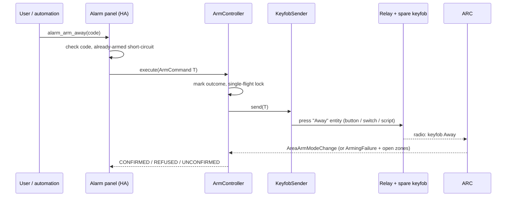

# 06 — Arming through a relay-driven keyfob

Status: **design, nothing implemented yet.** This is the plan for arming and
disarming the ARC from Home Assistant when the ARC's own arm RPC is out of
reach. It reuses the control layer that is already merged (`protocol/control.py`,
the alarm panels, the code check) and replaces only *how a command is sent*.

## 1. Why

The search for the ARC's arm RPC failed (see
[02-protocol.md §2c](02-protocol.md#2c-arm-search-results-2026-10-22-what-was-tried-and-what-it-showed)):
18 disarm-only trials over DHIP, with and without an alarm-user code, all return
one generic error, and DMSS arms arrive from the ARC's own loopback address. The
ARC does not appear to accept an arm request from a remote DHIP login.

The ARC does accept arm and disarm from a **paired wireless keyfob**. The owner's
ARC has one (`Keyfob0010`, model ARA24-W2: Home, Away, Disarm and SOS buttons,
868 MHz, two-way, AES128) and an LED keypad (`Keypad0149`, ARK30T-W2). If Home
Assistant can *press the keyfob's buttons electrically*, the ARC sees an ordinary
remote arm, does it itself with all its own checks (open zones, delays, event
log), and the integration confirms the result from the ARC's events exactly as it
already does.

The keypad is not used: it needs a multi-key code entry and has no practical
electrical interface.

## 2. How it works



Only the *send* step is new. Everything after it (waiting for
`AreaArmModeChange` / `ArmingFailure`, the one fallback `AreaArmMode` table
read, the result, the error messages) is the existing confirmation code.

## 3. Decisions

| Decision | Choice |
|---|---|
| What presses the buttons | Existing Home Assistant entities chosen by the user: `button`, `input_button`, `switch` or `script`. The integration never talks to relay hardware itself |
| Backend selection | New option `arm_backend`: `dhip` (the current behaviour, inert until a verified RPC exists) or `keyfob` |
| Modes | Home (`p1`) → the Home entity; Away (`T`) → the Away entity; disarm (`D`) → the Disarm entity. **No entity is ever offered for SOS** |
| Disarm | **Opt-in**, off by default (`keyfob_allow_disarm`). A relay that can disarm the house is a bigger risk than one that can only arm it |
| Panels | The **system panel only**: a keyfob arms the areas it is assigned to in the ARC, not areas individually. No per-area panels in keyfob mode |
| Confirmation | Reuse `wait_for_outcome` plus one table read, with a longer default wait (15 s) because the path includes a radio hop |
| Retries | **None.** A press with no confirming event ends as `UNCONFIRMED`; the integration never presses again on its own |
| Single flight | One command at a time, and a minimum gap between presses (5 s) |
| Force arm | Not supported in this backend; a keyfob has no second step. A refusal reports the open zones |
| Protocol isolation | The new sender lives in `protocol/` with **no `homeassistant` import**. It receives a blocking `press(entity_id)` callable from the integration |

## 4. Hardware (for the owner)

The integration does not depend on any particular relay, only on a Home
Assistant entity that "presses" a button. A typical build:

1. **Use a dedicated spare keyfob, never the one in daily use.** Buy a second
   ARA24-W2 and pair it to the ARC in DMSS (a one-off use of the app). Test it by
   hand first (section 7).
2. **Bridge three button contacts** on its board (Home, Away, Disarm) with an
   opto-isolated output or a dry-contact relay channel each, driven by an ESP32
   (ESPHome), a Shelly Plus Uni or similar. The keyfob runs on a 3 V coin cell:
   use isolated contacts, not a shared supply, and never connect mains to it.
3. **Leave SOS unwired.** Nothing in the integration can press it.
4. **Make each press momentary** (roughly 300 to 500 ms). In ESPHome that is a
   template `button` that turns the output on, delays, and turns it off. For a
   `switch` entity the integration can do the pulse itself (section 5.2).
5. **Mount the keyfob within radio range of the ARC or its repeater**
   (`AlarmRepeater0090` is already paired), away from large metal surfaces.
6. **Check the battery** now and then; a dead coin cell fails silently until the
   integration reports `UNCONFIRMED`.

## 5. Software design

### 5.1 Command senders in `ArmController`

`ArmController` today sends one DHIP RPC through a `CommandSpec`. It gains an
optional `sender`:

```python
class CommandSender(Protocol):
    name: str
    def send(self, command: ArmCommand) -> SendFailure | None: ...
```

- `send` returns `None` when the command was issued, or a `SendFailure`
  (`reason`, optional message) when nothing was issued. It never retries.
- With `sender=None` the controller behaves exactly as today (DHIP spec path), so
  existing tests and the inert `dhip` backend are untouched.
- `_execute_locked` keeps all its guards (known areas, supported mode, hub
  available, auth, stop event) and takes the outcome mark *before* the send. After
  a successful send it calls the existing `_confirm`.

### 5.2 `KeyfobSender` (`protocol/keyfob.py`)

```python
@dataclass(frozen=True)
class KeyfobButtons:
    home: str | None
    away: str | None
    disarm: str | None

class KeyfobSender:
    def __init__(self, buttons, press, is_ready, *, min_gap=5.0, clock=time.monotonic): ...
    def send(self, command): ...
```

- Maps `p1`, `T`, `D` to the configured entity. A mode with no configured entity
  fails with `mode_not_configured`; `p2` is unsupported.
- `is_ready(entity_id)` (injected) reports whether the relay entity exists and is
  not `unavailable`/`unknown`. If not, the send fails with `relay_unavailable`
  **before** anything is pressed.
- Enforces `min_gap` between presses (`too_soon`).
- Calls `press(entity_id)`: a blocking callable supplied by the integration. A
  press that raises is `press_failed` (after the call began, the press may have
  happened, so it is still never retried).
- The integration builds `press` from `hass.services.async_call` run on the event
  loop (`asyncio.run_coroutine_threadsafe(...).result(timeout)`), choosing by
  domain: `button.press` / `input_button.press`; `script.turn_on`;
  `switch.turn_on`, a hold of `keyfob_press_ms` (default 400), then
  `switch.turn_off`.

### 5.3 Confirmation and outcomes

| Result | When | Message key |
|---|---|---|
| `CONFIRMED` | `AreaArmModeChange` for every target area, or the table read shows the mode | none |
| `REFUSED` | `ArmingFailure` for a target area (open zones named from `Abnormal`) | `arm_refused_open_zones` / `arm_refused` |
| `UNCONFIRMED` | no event within the wait and the table is unchanged | `arm_unconfirmed` (text says the press may still have worked and is **not** retried) |
| `FAILED` | `relay_unavailable`, `press_failed`, `mode_not_configured`, `too_soon` | new keys, section 5.6 |
| `REJECTED` | busy, hub unavailable, unknown area | existing keys |

The existing short-circuit stays: if every target area is already in the
requested mode nothing is pressed.

### 5.4 Panels in keyfob mode

- Only `DahuaArcSystemPanel`, targeting every enabled area. No area panels (the
  ARC decides which areas a keyfob controls; section 8, question 1).
- `supported_features`: arm home / arm away as configured. Disarm is accepted only
  when `keyfob_allow_disarm` is on; otherwise `alarm_disarm` raises
  `disarm_not_enabled` and nothing is pressed.
- The Home Assistant code check (hash in options, rate limit and lockout) is
  unchanged and still gates disarm by default.
- State always comes from the ARC's events and table, never from the press.

### 5.5 Options, setup and diagnostics

New option keys (arm-control step of the options flow, shown only for the keyfob
backend):

| Key | Meaning |
|---|---|
| `arm_backend` | `dhip` (default) or `keyfob` |
| `keyfob_home_entity`, `keyfob_away_entity`, `keyfob_disarm_entity` | entity selectors (domains `button`, `input_button`, `switch`, `script`); disarm only asked when allowed |
| `keyfob_allow_disarm` | default `False` |
| `keyfob_press_ms` | momentary hold for `switch` entities, 100 to 2000, default 400 |
| `keyfob_wait_seconds` | confirmation wait, 5 to 60, default 15 |

Validation: the chosen backend needs at least one arm entity; each mode offered
by the panel needs its entity; disarm needs `keyfob_allow_disarm` and an entity.
`hub.setup_arm_control` builds the sender and the controller; in keyfob mode
`arm_control_unsupported` stays false, so no "not supported" repair appears. A new
repair (`keyfob_entity_missing`) is raised when a configured entity is no longer
in the registry. Diagnostics report the backend, which modes are mapped (not the
entity ids' states), the minimum gap and the last results; the HA code, its hash
and the ARC password stay out.

### 5.6 New error keys

`relay_unavailable`, `press_failed`, `mode_not_configured`, `too_soon`,
`disarm_not_enabled`. Each maps to a plain-language `translations/en.json`
exception, and `arm_unconfirmed` gains the "may still have worked, not retried"
wording for this backend.

### 5.7 Security

- Disarm is off by default; arm-only is a complete, useful setup.
- The panel code check stays in front of every command that requires it.
- The integration can press only the buttons the user mapped; SOS is not an
  option, and nothing presses on setup, reload, options or a timer.
- Anyone who can call Home Assistant services can arm; anyone who can call the
  *relay* entities directly can press the keyfob. Treat those entities like the
  panel: keep the Home Assistant account secured and do not expose them through
  voice assistants or shared dashboards.
- A press that is not confirmed is reported, never repeated.

## 6. Test plan

Against the in-process fake ARC (no hardware):

- `KeyfobSender`: mode mapping; unmapped mode; relay unavailable (nothing pressed);
  press exception (not retried); minimum gap; press called exactly once.
- `ArmController` with a sender: confirmed by event; confirmed by the table after
  the event is lost; refused with open zones; unconfirmed (and **one** press);
  busy; already-in-mode short-circuit; sender failure outcomes.
- The fake ARC gains a "keyfob" helper that, when the test's `press` is called,
  emits the same events a real arm produces (`GlobalAreaArmModeChange` plus one
  `AreaArmModeChange` per area; or `ArmingFailure` with `Abnormal`).
- Home Assistant layer: options flow validation and defaults; system panel only;
  disarm disabled by default; the code gate; the `press` bridge for each entity
  domain; repairs; diagnostics redaction; existing entity ids unchanged.
- A source scan keeps `protocol/` free of `homeassistant` imports.

## 7. Hardware acceptance (owner, before relying on it)

1. Pair the spare keyfob. Press Home, Away and Disarm by hand and watch the
   integration's arm-state sensor and its `TriggerMode`. Record whether the
   keyfob refuses with an open zone, forces the arm, or asks for a second press.
2. Wire the relay channels. Press each through its Home Assistant entity and
   confirm the same result.
3. Run the panel's arm Away, arm Home and (if enabled) disarm five times each.
4. Remove the keyfob battery: arm must end `UNCONFIRMED` with no second press.
5. Unplug the relay device: arm must fail with `relay_unavailable` and nothing
   must press.
6. Arm with a door open: the error must name the zone.
7. Restart Home Assistant while armed: the panel must come back armed.

## 8. Open questions (answered by step 1 above)

1. **Which areas does a keyfob arm?** The keyfob is assigned to areas in DMSS
   (`Keyfob0010` shows `LivingRoom`). The system panel must target exactly the
   areas the spare keyfob controls, so this decides whether a subset option is
   needed (the default is every enabled area).
2. **What does a keyfob do with open zones?** Refuse (then the refusal and zones
   arrive as `ArmingFailure`), force, or require a second press.
3. **Is there an exit delay** after a keyfob Away, and which events mark it
   (also open question Q9 in 02)?
4. **Radio range and reliability** from where the spare keyfob will sit.

## 9. Phases

1. This design note (docs only).
2. `ArmController` sender abstraction, `KeyfobSender`, the fake-ARC keyfob helper
   and their tests (no Home Assistant changes).
3. Home Assistant layer: options flow, panel in keyfob mode, the `press` bridge,
   repairs, translations, diagnostics, README and CHANGELOG, and tests.
4. Owner's hardware acceptance, then a release.
